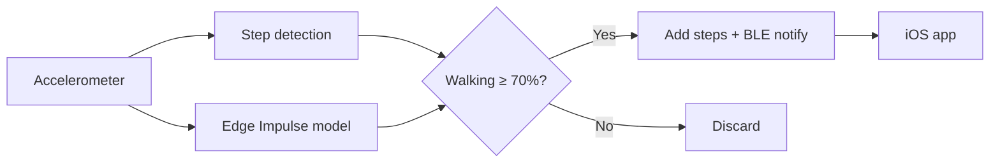

# BLE Pedometer Wearable

A wearable step counter built for **Bruin Software Engineering (BSE)** at UCLA (Health Tech in Hardware track).

An Arduino reads its accelerometer and detects possible steps. An [Edge Impulse](https://edgeimpulse.com) ML model checks whether you're actually walking, so arm swings and fidgeting don't count. The step total is sent over **Bluetooth Low Energy (BLE)** to a SwiftUI **iOS app**.

## How it works



1. The board fills a window of accelerometer samples and flags candidate steps (spikes in acceleration >1.2 g).
2. The model classifies the window as `Walking` or `Idle`.
3. Steps are only counted if the model says `Walking` with at least 70% confidence.
4. The new total is sent to the iOS app over BLE.

## Repository layout

```
firmware/pedometer/pedometer.ino   # Arduino sketch: BLE, step detection, ML inference
ios-app/StepTracker/               # SwiftUI + CoreBluetooth app
edge-impulse/dataset/              # Labeled accelerometer training/testing data
```

## Hardware

- An Arduino with an onboard IMU and BLE (e.g. Nano RP2040 Connect or Nano 33 BLE)
- USB cable, plus an optional battery and strap for wearing it

The sketch uses `Arduino_LSM6DSOX` (Nano RP2040 Connect). On a Nano 33 BLE use `Arduino_LSM9DS1`, or `Arduino_BMI270_BMM150` on the BLE Sense Rev2.

## Getting started

### Firmware

1. In the Arduino IDE, install the board package for your board and the `ArduinoBLE` + IMU libraries.
2. In Edge Impulse Studio, go to **Deployment → Arduino library**, download the `.zip`, and add it via **Sketch → Include Library → Add .ZIP Library…**. Make sure the `#include <..._inferencing.h>` line matches the library name.
3. Open `firmware/pedometer/pedometer.ino` and upload it. (The first compile takes a few minutes.)
4. Open the Serial Monitor at **115200 baud** to see the model output and step count.

### iOS app

Requires **iOS 17+** and a physical iPhone (the simulator has no Bluetooth).

1. Create a new SwiftUI app in Xcode and replace its files with those in `ios-app/StepTracker/`.
2. Add `NSBluetoothAlwaysUsageDescription` (Privacy – Bluetooth Always Usage Description) to the target's Info.
3. Set your signing team and run it on your iPhone.

### Using it

1. Power the board. It advertises as **Step Tracker**.
2. In the app, tap **Scan**, then **Connect** on *Step Tracker*.
3. Tap **Subscribe** on the step characteristic and start walking. The **Decimal** value is your step count.

## BLE interface

| Item | Value |
|---|---|
| Local name | `Step Tracker` |
| Service UUID | `49B10010-E8F2-537E-4F6C-D104768A1214` |
| Step characteristic | `49B10011-E8F2-537E-4F6C-D104768A1214` (Read, Notify) |
| Format | `uint32`, little-endian, steps since power-on |

## Edge Impulse model

Trained on about 3 minutes of labeled `Walking` / `Idle` accelerometer data (~100 Hz) collected with the Edge Impulse data forwarder, using a Spectral Analysis block and a Classification block. The raw data is in `edge-impulse/dataset/`.

## Acknowledgements

- **Bruin Software Engineering (BSE)**, UCLA
- [Edge Impulse](https://edgeimpulse.com), [ArduinoBLE](https://github.com/arduino-libraries/ArduinoBLE), and Apple [CoreBluetooth](https://developer.apple.com/documentation/corebluetooth)
